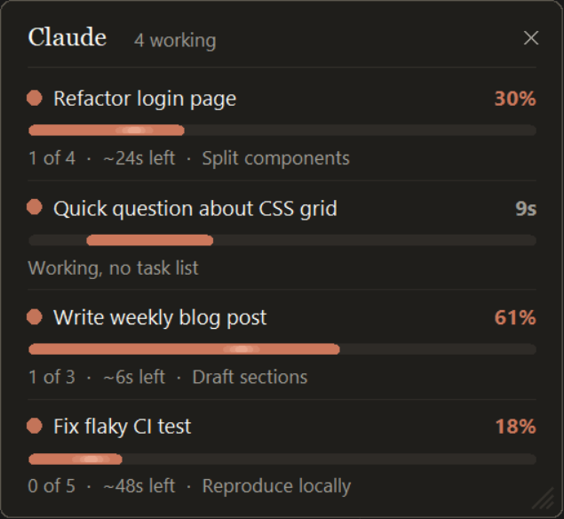

# Task progress widget for Claude (Windows)

A small floating window that shows what Claude is working on. Each Claude session that's busy gets its own line with the session's title, a bar that fills as Claude works through its task list, and a rough estimate of the time left. When a session finishes, its line turns green for a few seconds and then goes away.

> Unofficial. This is a community project and isn't made by, affiliated with, or endorsed by Anthropic. "Claude" is a trademark of Anthropic.

## Status

Early. It works on the PC it was built on and hasn't been tried on many others yet. If something doesn't work on yours, please open an issue and say what you see.

## Requirements

- Windows 10 or 11
- The Claude desktop app, using the Code tab. The bar is driven by the task list Claude keeps there, so plain terminal Claude Code won't fill it.
- Python 3 with tkinter. The installer from [python.org](https://www.python.org/downloads/) includes it with the default options.

## Install

1. Download this repository as a ZIP (green **Code** button, then **Download ZIP**) and unzip it anywhere.
2. Double-click `install.bat`. A console window shows each step and waits for a key press at the end.
3. Fully quit Claude and open it again. Closing the window isn't enough: right-click its icon in the taskbar or system tray and choose Quit.

The widget appears in the top-right corner of your main screen. It opens by itself when you sign in to Windows, and there's a **Claude Progress** shortcut on your desktop if you close it.

## Using it

- Drag it anywhere to move it.
- Drag the bottom-right corner, or hold Ctrl and scroll over it, to resize it. The size is remembered.
- Click the x to close it.
- If Claude isn't using a task list for a job (quick questions, for example), the line shows a block sliding back and forth instead of a filling bar.

When Claude controls your computer, the app minimizes other windows, this one included. The widget comes straight back, and for about a minute it ignores clicks and stays out of screen captures so it can't get in Claude's way. After that it behaves normally again.

## Uninstall

Double-click `uninstall.bat`, then restart Claude.

## What the installer changes

- Copies `task-progress-bar` to `%USERPROFILE%\.claude\mods\task-progress-bar`.
- Sets `CLAUDE_CODE_PLUGIN_DIRS` in `%USERPROFILE%\.claude\settings.json` so Claude loads it. Your other settings are kept, and a backup of the old file is saved next to it first. If that variable already points at a different folder, the installer leaves it alone and tells you what to add.
- Adds a desktop shortcut and a shortcut in the Windows Startup folder.

## How it works

There are two parts:

- **The mod** (`task-progress-bar/hooks/register.tsx`) runs inside Claude. It watches Claude's task-list updates and writes a small JSON file per session to `%USERPROFILE%\.claude\task-progress`, refreshed about once a second while a turn is running.
- **The widget** (`task-progress-bar/widget/progress_widget.py`) is a Python/tkinter window that reads those files and draws one line per working session.

Session titles come from the Claude app's own session files. Those aren't a public format, so a future app update could change them. If that happens, lines fall back to the start of the message you sent instead of the title.

## License

MIT. See [LICENSE](LICENSE).
