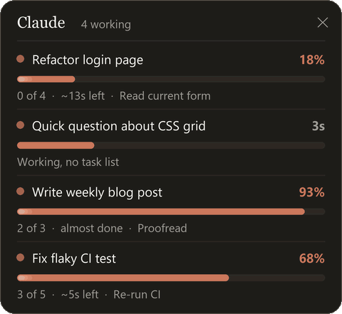

# Task progress widget for Claude (Windows)

A small floating window that shows what Claude is working on. Each Claude session that's busy gets its own line with the session's title, a bar that fills as Claude works through its task list, and a rough estimate of the time left. A session that needs you (a permission prompt, or a question) turns amber. When a session finishes, its line turns green for a few seconds and then goes away.

> Unofficial. This is a community project and isn't made by, affiliated with, or endorsed by Anthropic. "Claude" is a trademark of Anthropic.

## Status

Early. It works on the PC it was built on and hasn't been tried on many others yet. Terminal Claude Code support is new: it has been tried in one real terminal session, where the session showed up and finished correctly, but the filling bar and the permission prompt haven't been seen there yet. If something doesn't work on yours, please open an issue and say what you see.

## Requirements

- Windows 10 or 11
- The Claude desktop app (Code tab), or Claude Code in a terminal
- Nothing else if you use the release download. Running from the source code needs Python 3 with tkinter, which the installer from [python.org](https://www.python.org/downloads/) includes with the default options.

## Install

1. Download the ZIP from the [latest release](https://github.com/OhMyGodItIsMe/task-progress-widget/releases/latest) and unzip it anywhere. It includes a ready-made `TaskProgressWidget.exe`, so you don't need Python.
2. Double-click `install.bat`. A console window shows each step and waits for a key press at the end.
3. Fully quit Claude and open it again. Closing the window isn't enough: right-click its icon in the taskbar or system tray and choose Quit. Terminal sessions you start after installing pick it up on their own.

The widget appears in the top-right corner of your main screen. It opens by itself when you sign in to Windows, and there's a **Claude Progress** shortcut on your desktop if you close it.

Windows may warn that the .exe is from an unknown publisher, because it isn't code-signed. Choose "More info", then "Run anyway", or use the source version with Python instead.

## Using it

- Click a line to jump to that session in the Claude app. (Terminal sessions, marked with ›, can't be opened this way.)
- Drag it anywhere to move it. It reopens where you left it.
- Drag the bottom-right corner, or hold Ctrl and scroll over it, to resize it.
- Right-click it for settings: its own sound when a session finishes (a soft chime) or needs you (a rising "ding-DING"), the theme (match Windows, dark, or light), and resetting its size and position.
- If Claude isn't using a task list for a job (quick questions, for example), the line shows a block sliding back and forth instead of a filling bar. In a terminal, Claude often skips the task list for small jobs, so expect the sliding block more often there.

When Claude controls your computer, the app minimizes other windows, this one included. The widget comes straight back, and for about a minute it ignores clicks and stays out of screen captures so it can't get in Claude's way. After that it behaves normally again.

## Uninstall

Double-click `uninstall.bat`, then restart Claude.

## What the installer changes

- Copies `task-progress-bar` to `%USERPROFILE%\.claude\mods\task-progress-bar`.
- In `%USERPROFILE%\.claude\settings.json`, sets `CLAUDE_CODE_PLUGIN_DIRS` so the desktop app loads the mod, and adds hooks for terminal Claude Code. Your other settings and hooks are kept, and a backup of the old file is saved next to it first. If `CLAUDE_CODE_PLUGIN_DIRS` already points at a different folder, the installer leaves it alone and tells you what to add. Run `install.ps1 -NoTerminalHooks` to skip the hooks.
- Adds a desktop shortcut and a shortcut in the Windows Startup folder.

## How it works

There are three parts:

- **The mod** (`task-progress-bar/hooks/register.tsx`) runs inside the Claude desktop app. It watches Claude's task-list updates and permission prompts, and writes a small JSON file per session to `%USERPROFILE%\.claude\task-progress`, refreshed about once a second while a turn is running.
- **The terminal hook** (`task-progress-bar/cli/progress-hook.ps1`) does the same for Claude Code in a terminal. Claude Code runs it in the background on events such as a new prompt, a task created or completed, a permission prompt, and the end of a turn. Desktop sessions are skipped there, since the mod covers them.
- **The widget** (`task-progress-bar/widget/progress_widget.py`, shipped as `TaskProgressWidget.exe`) is a tkinter window that reads those files and draws one line per session.

Session titles and the links for opening a session come from the Claude app's own session files. Those aren't a public format, so a future app update could change them. If that happens, lines fall back to the start of the message you sent, and clicking a line does nothing.

To build the release ZIP yourself, install PyInstaller (`python -m pip install --user pyinstaller`) and run `make-release.ps1`.

## License

MIT. See [LICENSE](LICENSE).
